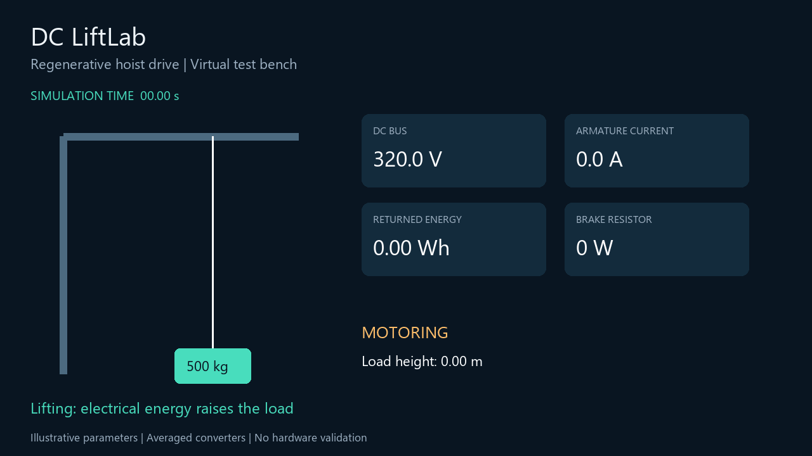
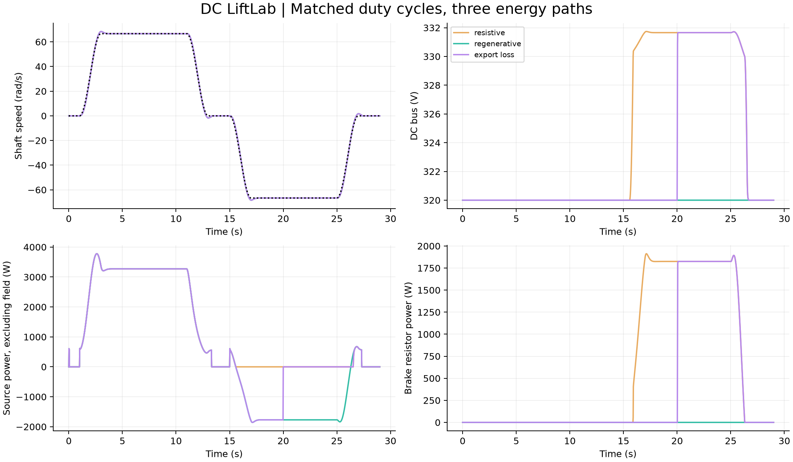
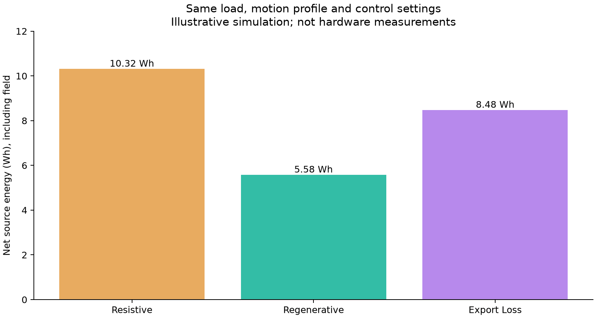

# DC LiftLab

**Regenerative DC Hoist Drive: Control, Energy Recovery & Protection**

A reproducible power-engineering virtual test bench by **Abdullah Alruwaili**, developed with AI assistance and intended for author review and reproduction.



[Watch the narrated edition: English voice with Arabic subtitles (80 seconds)](results/demo_narrated_ar.mp4). The last 20 seconds compare the scenarios and summarize verification. [Narration transcript](docs/ENGLISH_NARRATION.md).

Compare matched lift/lower cycles with resistor braking, regenerative braking and loss of source receptivity. Follow the energy from the source through the converters and machine to the payload, then back during lowering.

## Run

Python 3.10 or newer:

```bash
python -m venv .venv
# Windows: .venv\Scripts\activate
# macOS/Linux: source .venv/bin/activate
python -m pip install -r requirements.txt
python run_project.py
python -m unittest discover -s tests -v
```

Open `results/dashboard.html` in a browser for interactive scenario selection and timeline replay. No server or internet connection is required. The replay shows generated Python traces; it does not run a second physics model in JavaScript.

For a standard-library-only run (metrics, CSV, dashboard, sensitivity and convergence):

```bash
python run_project.py --no-media
```

For MP4 generation, optionally install `imageio-ffmpeg` before running. The default media path always creates figures and a GIF; MP4 is additionally generated when the encoder package is available.

## Results and evidence

- [Computed results](results/RESULTS.md)
- [Engineering report](docs/ENGINEERING_REPORT.md)
- [Parameters and provenance](configs/README.md)
- [Publication kit](docs/PUBLICATION_KIT.md)
- [Project status](docs/STATUS.md)




The scenario results are simulations with illustrative parameters. They are not measured savings or evidence of a commissioned industrial installation. See the generated results for the exact duty cycle outcome.

## Model

Separately excited DC machine at fixed flux; armature inductance; rotor and reflected payload inertia; gravitational load; brush and copper losses; viscous friction; field input; averaged four-quadrant drive; cascaded speed/current PI; finite source import/export capability; DC capacitor; brake chopper; simplified holding brake.

The four-quadrant claim is verified using a separate inertial-load reversal benchmark. A standard hoist cycle need not visit all four quadrants.

## Reproducibility

`configs/baseline.json` records the initial assumptions. Run `python run_project.py --config configs/baseline.json` to use them explicitly. Every run writes `results/parameters_used.json`. Raw CSV traces are decimated to 20 ms; metrics use every integration step. The core simulation requires only the Python standard library. `requirements-lock.txt` records the versions used for supplied media.

## Boundaries

Fixed nominal flux, ideal gearbox, omitted iron losses, no rope elasticity, average converter losses, idealized brake release. PWM ripple, grid harmonics, switching-device stresses, field-loss recovery and safety certification are outside the verified scope. The bus trip latch is a diagnostic mechanism, not a complete emergency stop. Data-sheet identification and physical bench validation are future work.

## Repository layout

```text
dc_liftlab/      physics model, media generator, replay template
configs/        default parameters and their provenance
tests/          independent physics and behavior checks
results/        CSV, JSON, figures, replay and video
docs/           derivation, status and publication materials
run_project.py  one-command experiment runner
```

Suggested repository name: `dc-liftlab`. Suggested topics: `dc-motor`, `power-engineering`, `regenerative-braking`, `motor-control`, `power-electronics`, `python`, `simulation`.
